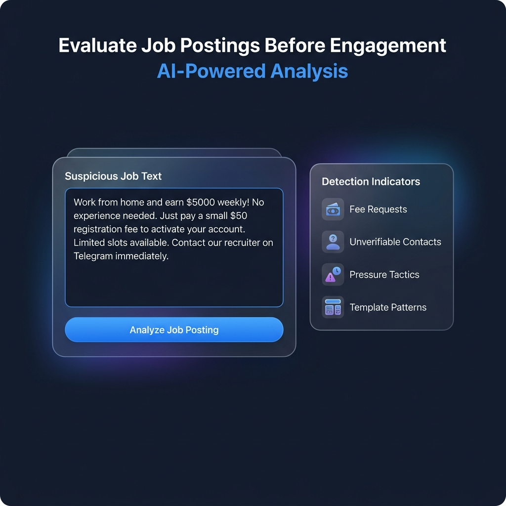
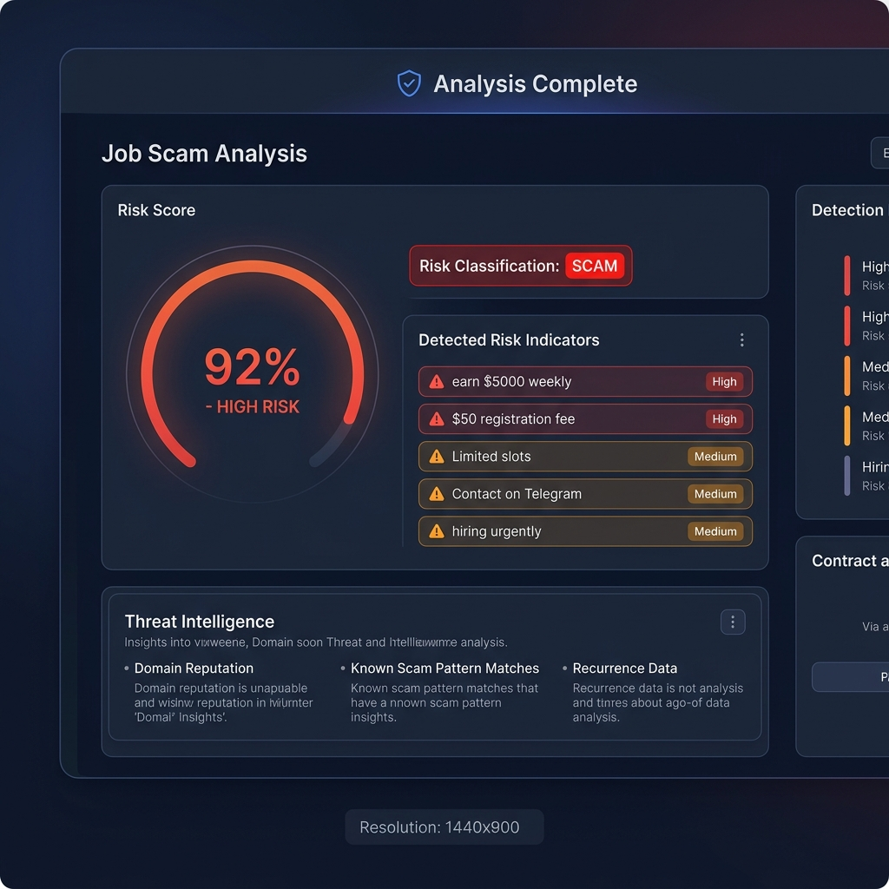
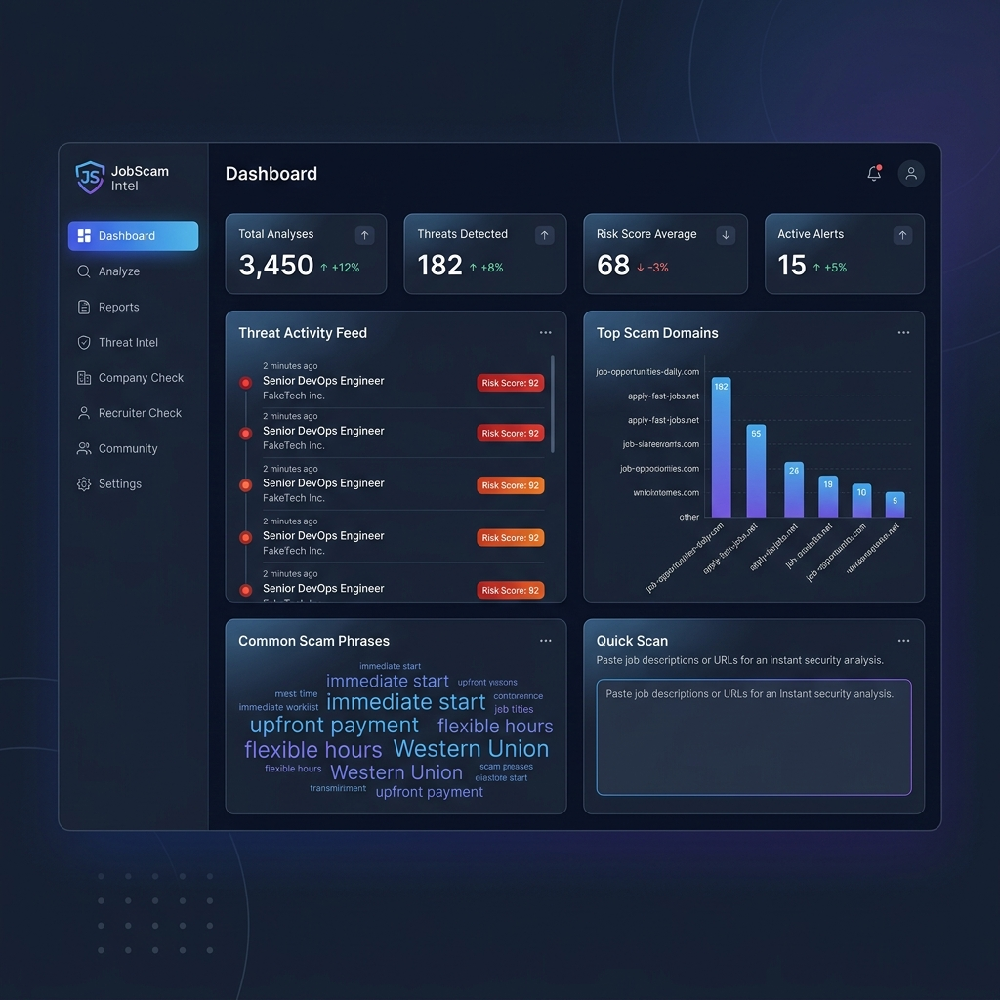
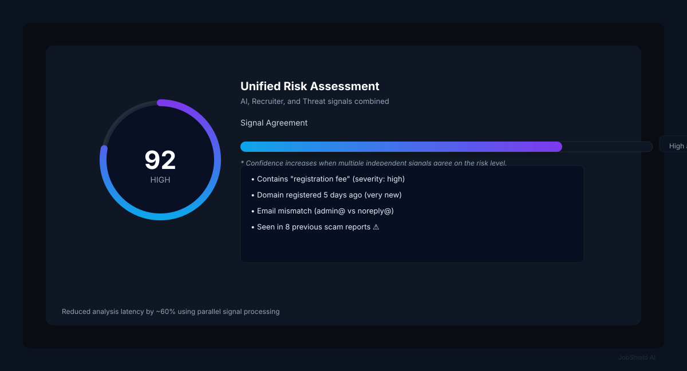
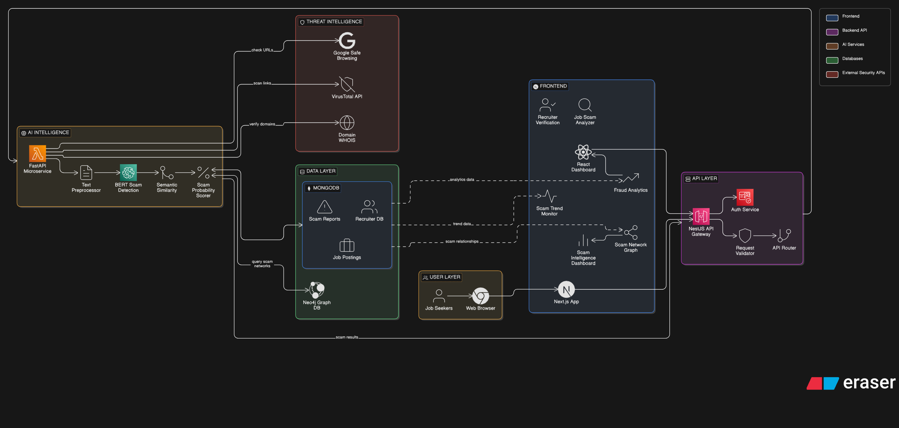

<div align="center">

# 🛡️ JobShield AI

### AI-Powered Job Scam Detection & Threat Intelligence Platform

[](https://opensource.org/licenses/ISC)
[](https://nodejs.org/)
[](https://www.python.org/)
[](https://nextjs.org/)
[](https://react.dev/)
[](https://www.typescriptlang.org/)
[](https://fastapi.tiangolo.com/)
[](https://www.mongodb.com/)

**JobShield AI** protects job seekers and hiring platforms from online employment scams, fake recruiters, and fraudulent work-from-home schemes. By analyzing job descriptions, recruiter contacts, and company domains, it delivers instant, easy-to-understand verdicts backed by real threat intelligence.

[Screenshots](#-product-screens) • [How It Works](#-how-it-works) • [Key Features](#-key-features) • [Why JobShield](#-why-jobshield) • [Architecture](#-how-it-is-built) • [Quick Start](#-quick-start) • [API](#-api-quick-reference)

</div>

---

## 🖥️ Product Screens

### 📋 1. Paste & Analyze
Submit any suspicious job post, recruiter email, or company URL for instant evaluation.

<div align="center">



</div>

---

### 🎯 2. Clear Risk Verdict & Evidence
See an immediate risk rating (0–100%), highlighted red flags, and recruiter legitimacy checks.

<div align="center">



</div>

---

### 📊 3. Threat Intelligence Hub
Track recurring scam patterns, suspicious domains, and high-risk phrases across all community reports.

<div align="center">



</div>

---

## ⚡ How It Works

```
1. Paste text ────► 2. AI & Threat Check ────► 3. Instant Decision
   Job posting,        Scans for fee requests,    Risk rating (Low / High),
   recruiter email,    newly made domains, and    highlighted warning signs,
   or website URL.     known scam patterns.       and actionable advice.
```

### Quick Test via API
```bash
curl -X POST http://localhost:4000/api/jobs/analyze \
  -H "Content-Type: application/json" \
  -d '{"text": "Work from home! Earn $5,000/week. No experience needed. Pay $99 registration fee via crypto."}'
```

---

## 🎁 Key Features

- 🔍 **Instant Scam Detection**: Detects common fraud patterns including upfront training/equipment fees, unrealistic salaries, pressure tactics, and fake check schemes.
- 💡 **Explainable Decisions (No Black Box)**: Every score clearly explains *why* a posting was flagged, highlighting specific suspicious phrases and explaining the risk.
- 👤 **Recruiter & Domain Verification**: Checks whether recruiter emails and company domains are legitimate, newly created, or linked to disposable webmail services.
- 🌐 **Official Threat Intelligence**: Cross-references offers against official public warning databases from the **Federal Trade Commission (FTC)** and **FBI IC3**.
- 🕸️ **Scam Network Mapping**: Visualizes hidden relationships between suspicious phone numbers, email domains, and payment handles.
- 📄 **Exportable Audit Reports**: Download professional PDF investigation reports to share with fraud investigators or employment platforms.
- 📢 **Community Scam Reporting**: Helps build a shared fraud defense database so newly discovered scams protect everyone.

---

## 🎯 Why JobShield?

Most scam checkers only check keywords. JobShield evaluates the entire context:

| What We Check | Why It Matters |
|---|---|
| **Text & Language** | Uncovers urgency tactics, unrealistic compensation, and payment demands |
| **Recruiter Identity** | Flags mismatched email headers, free webmail impersonation, and disposable addresses |
| **Domain Authenticity** | Detects domains registered only days ago or mimicking reputable companies |
| **Threat Recurrence** | Matches patterns against known fraud campaigns seen in prior reports |

<div align="center">



</div>

---

## 📈 Accuracy & Performance

- **Tested on Real-World Datasets**: Evaluated against 100+ verified job listings (authentic job postings vs. active scams).
- **82% Precision & 80% F1 Score**: Highly effective at catching deceptive offers while keeping false alarms low.
- **Sub-Second Results**: Standard scans complete in under a second for an effortless user experience.
- **Safe-First Review Strategy**: If an offer looks ambiguous, JobShield flags it for caution rather than making misleading guesses.

---

## 🏗️ How It Is Built

JobShield AI uses a modern, modular design:

<div align="center">



</div>

- **Web Frontend**: Built with **Next.js 15**, **React 19**, and **Tailwind CSS** for a clean, responsive interface.
- **Backend API Gateway**: Built with **Node.js**, **Express**, and **TypeScript**, providing secure authentication and database access.
- **AI Intelligence Microservice**: Built with **Python** and **FastAPI**, handling natural language processing, model evaluation, and vector search.
- **Database**: **MongoDB Atlas** storing threat indicators, reports, and scam campaign relationships.

---

## 🚀 Quick Start

### Prerequisites
- **Node.js** (v20+)
- **Python** (v3.11+)
- **MongoDB** (Local or MongoDB Atlas)

### 1. Clone & Install
```bash
git clone https://github.com/pranav-pachn/Jobshield-AI.git
cd Jobshield-AI

# Install frontend and backend packages
npm install

# Set up Python virtual environment for AI service
python -m venv .venv
# On Windows: .venv\Scripts\activate
# On macOS/Linux: source .venv/bin/activate
pip install -r ai-service/requirements.txt
```

### 2. Configure Environment
```bash
# Copy example backend environment
cp backend/.env.example backend/.env
```
*(Ensure `MONGODB_URI` and `JWT_SECRET` are configured in `backend/.env`)*

### 3. Seed Threat Knowledge
```bash
# Load foundational FTC and FBI fraud threat data into MongoDB
python scripts/seed_rag.py
```

### 4. Start the Application
Open three terminal windows:

```bash
# Terminal 1: AI Service
cd ai-service
uvicorn app.main:app --port 8000 --reload

# Terminal 2: Backend API
cd backend
npm run dev

# Terminal 3: Frontend Web App
cd frontend
npm run dev
```

Open **http://localhost:3000** in your browser to start using JobShield AI!

---

## 🧪 Testing

Run automated checks to verify your setup:

```bash
# Quick smoke test (sample scans)
npm run smoke:test:quick

# Full dataset evaluation
npm run smoke:test:full

# End-to-end audit
npx ts-node backend/scripts/verifyGoldenPath.ts
```

---

## 📚 API Quick Reference

| Method | Endpoint | Description |
|---|---|---|
| `POST` | `/api/jobs/analyze` | Quick scam check for any job description |
| `POST` | `/api/investigations` | In-depth multi-signal scam investigation |
| `GET` | `/api/investigations/:id` | Get investigation verdict and evidence breakdown |
| `POST` | `/api/domains/check` | Verify company website age, SSL, and safety status |
| `POST` | `/api/recruiters/check` | Check recruiter email validity and trust score |
| `GET` | `/api/intelligence/overview` | Fetch live threat statistics and common scam patterns |
| `GET` | `/api/reports/investigation/:id` | Download PDF audit report for an investigation |

---

## 🔒 Security & Privacy

- **Data Protection**: Job texts are analyzed securely and sanitized to prevent injection attacks.
- **Privacy-Focused**: User account data is protected with JWT authentication and encrypted passwords.
- **Access Control**: Role-based permissions keep public checks open while protecting administrative moderation.

---

## 📄 License

This project is licensed under the **ISC License**.

---

<div align="center">

**Built to create a safer digital job search for everyone.**

[⬆ Back to Top](#-jobshield-ai)

</div>
